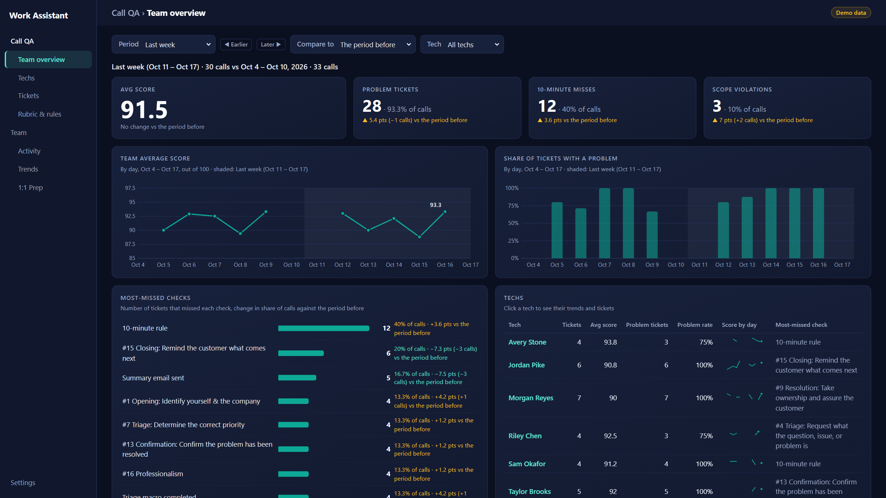
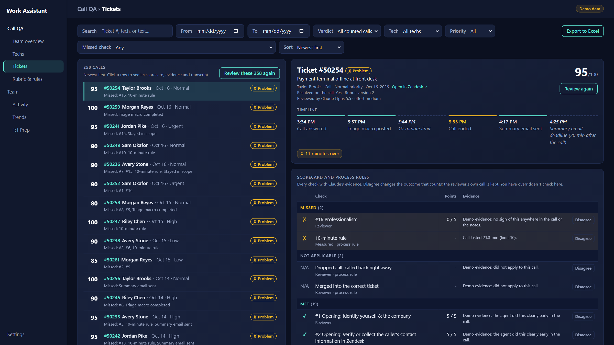
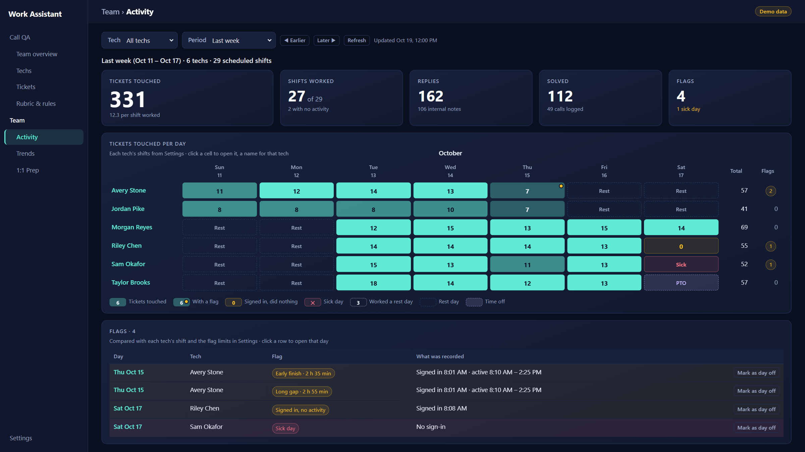
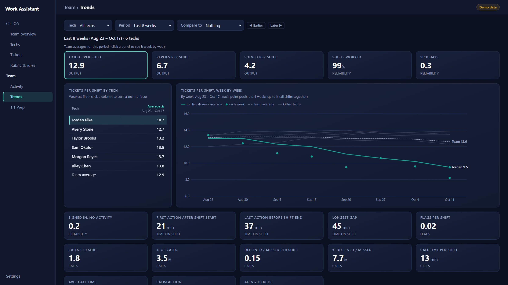
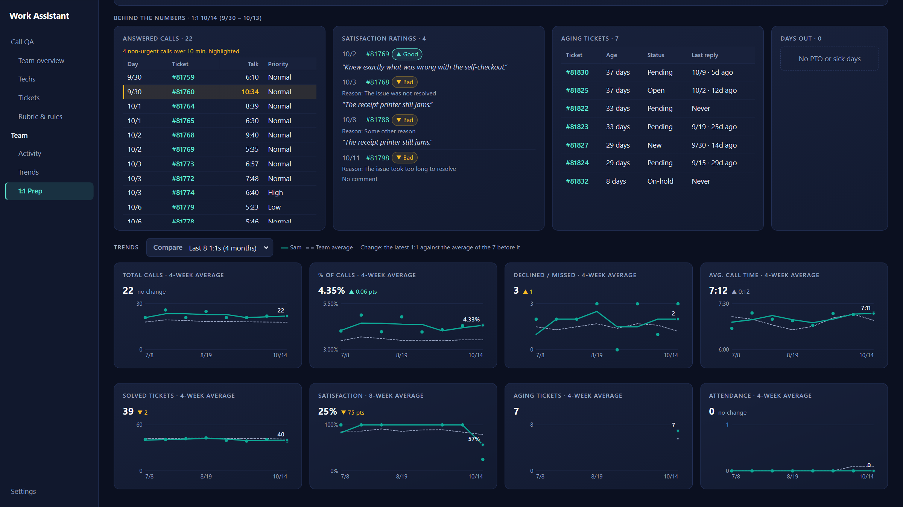

# Work Assistant

A browser app for a support team lead. Claude scores the team's support calls against the team's own scorecard, and
each tech's daily activity, trends and 1:1 prep are a click away. I use it every day at work, and a hosted copy of
its Team section serves the other team leads and managers.



*Every screenshot here is from the app's demo mode, which uses invented people and tickets.*

## What it does

**Call QA**
- Each morning it reads yesterday's inbound calls from Zendesk (read-only: it never changes anything there).
- Claude scores each first call against the team's scorecard and process rules and quotes the evidence for every
  check. Measured rules, such as "a call longer than 10 minutes is a miss", are checked from the call's own timing.
- The lead can disagree with any check. The override counts, and the reviewer's own call is kept beside it.
- A budget limit guards every run, the scorecard and rules are edited and versioned in the app, and a "Test a model"
  view compares another Claude model against the shown reviews before switching.
- Team, tech and ticket views, with trends against the period before and an Excel export.



**Team activity**
- What each tech did each day, from Zendesk's own records (replies, internal notes, logged calls, solved tickets and
  sign-ins), set against their shifts, rest days and time off.
- Flags such as a late first action, an early finish or a long gap, measured against limits the lead sets.



**Trends**
- Eighteen measures (output, reliability, time on shift, calls, satisfaction, backlog), each ranked by tech and drawn
  week by week. The lines are pooled averages, so a slow week or a few survey answers don't swing them.



**1:1 Prep**
- Each tech's numbers for the two weeks before their own 1:1 day, ready to paste into the 1:1 sheet with one click.
- Behind every number, the calls, ratings, aging tickets and days out that make it up, and trend graphs for each
  measure against the team.



**Where it runs**
- On the lead's Windows PC, at `127.0.0.1` only. Call data goes only to a local SQLite file and to Anthropic for the
  review.
- A hosted copy of the Team section (Activity, Trends, 1:1 Prep) runs on an Ubuntu server behind Cloudflare Access
  for the other leads, with admin, team lead and manager roles. The hosted copy never calls Claude.
- On the PC, the Zendesk token and the Anthropic API key are kept in Windows Credential Manager, never in a file.

## Run it

You need Windows and Python 3.12. The demo needs no Zendesk account and no API key:

```powershell
py -3.12 -m venv .venv
.venv\Scripts\python -m pip install -e ".[dev]"
.venv\Scripts\work-assistant serve --demo
```

The app opens in your browser with a year of invented history. Add `--demo-date 2026-10-19` to pin the demo to one
day (the screenshots use it), or `--edition hosted` to see the hosted copy as its admin.

Run the tests:

```powershell
.venv\Scripts\python -m pytest
```

To use it for real, `work-assistant setup` asks for a Zendesk API token and an Anthropic API key, and
`work-assistant schedule install` adds the daily review to Windows Task Scheduler. `work-assistant --help` lists
every command.

## How it works

A Python package (FastAPI and uvicorn for the server, SQLite for storage, httpx for Zendesk, the Anthropic SDK for
reviews) serving hand-written HTML, CSS and JavaScript with no front-end framework or build step. The charts are SVG
drawn by a small `charts.js`. About 18,000 lines of Python and 12,000 of JavaScript and CSS.

**Fetching from Zendesk.** The Zendesk client is read-only by construction: every request passes through an httpx
hook that raises before anything is sent if the method is not GET. `zendesk/normalize.py`, the only module that
knows Zendesk's field names, turns a ticket into the tech's part of one inbound call: the call record, transcript,
call summary, triage note and the summary email sent afterward, plus the merged-into ticket when there is one.

**Measured rules are code, not AI.** Rules that depend on time (call length against the limit, whether and when the
summary email went out, the gap before a callback) are decided in `timing.py` from the timestamps, rounding up so a
displayed "10.1 min" never contradicts a strict limit. Claude gets those outcomes as final facts and judges only
the remaining checks. `scoring.py` turns the outcomes into a score and a verdict as pure functions, with the lead's
override taking the place of the reviewer's outcome wherever there is one.

**Reviewing with Claude.** Each run sends one request per call through the Message Batches API at half the price.
The system prompt (instructions, the scorecard and process rules, and the reference documents they cite) depends
only on the rubric version and is rendered byte for byte the same every time, so it is held in the prompt cache for
an hour. Ticket text is wrapped in tags with `&`, `<` and `>` escaped, and the prompt says that nothing inside them is
an instruction. Output is strict JSON: the schema is built per call from the exact check ids the model must answer,
and the result is checked again on return. Results are matched to calls by id, a cut-off or malformed answer is
retried once, and refusals are stored as they are and shown in plain English.

**Runs that survive interruption.** Every save of the scorecard or rules is a new immutable version. A run freezes
its rubric version, model and effort and records the calls it covers, so a run paused or interrupted mid-batch
finishes on exactly what it started with. Creating a batch is never retried, since a retry after a timeout could
create a second paid batch: the run is committed as `submitting` first, and an unclear outcome holds its calls until
the lead checks. Before submitting, the run estimates its cost from token counts and each model's measured output
per call, and waits for confirmation when the estimate is over the budget limit. A model test re-scores stored calls
with another model and pairs each result with the review it is compared against, so its report never changes later.

**Team activity, Trends and 1:1 Prep.** An hourly sync reads Zendesk's incremental exports (ticket events, Talk call
legs and calls, satisfaction ratings) forward from where the last read stopped, saving its position only after each
page commits, so a failed read resumes cleanly. Each ticket event is split into what the tech did themselves and what
a trigger did in the same save. Days are judged on each tech's region clock (Dallas, Dubai or Manila time), and the
schedule can be imported from a Teams Shifts Excel export with openpyxl. Trend lines pool the tallies over a trailing
window (four weeks, eight for satisfaction) instead of averaging weekly ratios, so a quiet week doesn't swing them.
1:1 numbers are counted from the stored data each time the page is opened, so nothing is stored that can go stale.

**Two editions, one codebase.** The PC runs the full app on `127.0.0.1`, with secrets in Windows Credential Manager
through keyring and the daily review in Task Scheduler. The hosted edition answers every Call QA route with 404 and
checks each request's Cloudflare Access token (RS256 signature, audience, expiry and issuer against Cloudflare's
published keys, re-read when they rotate) with PyJWT. It runs under systemd timers for the hourly sync and nightly
backups, made with SQLite's online backup API. Customer text (transcripts, evidence, rating comments) is erased once
it is older than the retention period, while the scores and counts are kept, so trends survive.

**Demo and tests.** `serve --demo` builds a year of invented history by running the real pipeline with only the
reviewer swapped for an offline stand-in that answers from the request's own schema. Over 2,000 pytest tests cover
the Python side with fakes for Zendesk and the Batches API, and the front end's builders are tested in Node against
a small fake DOM, including chart layout and touch handling.

Built with Claude Code.

## License

MIT. See [LICENSE](LICENSE).
